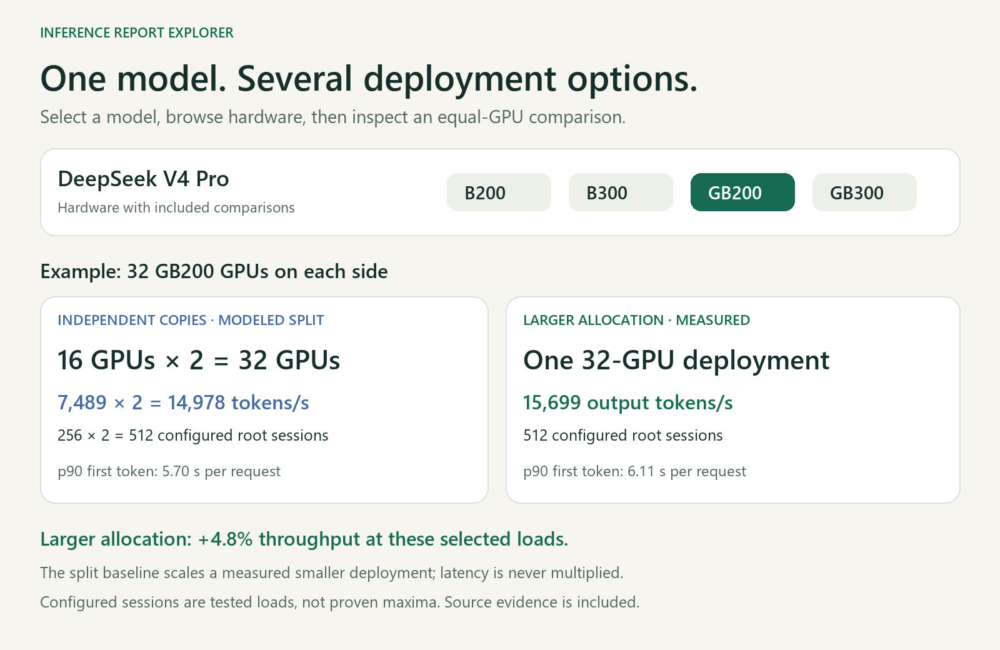
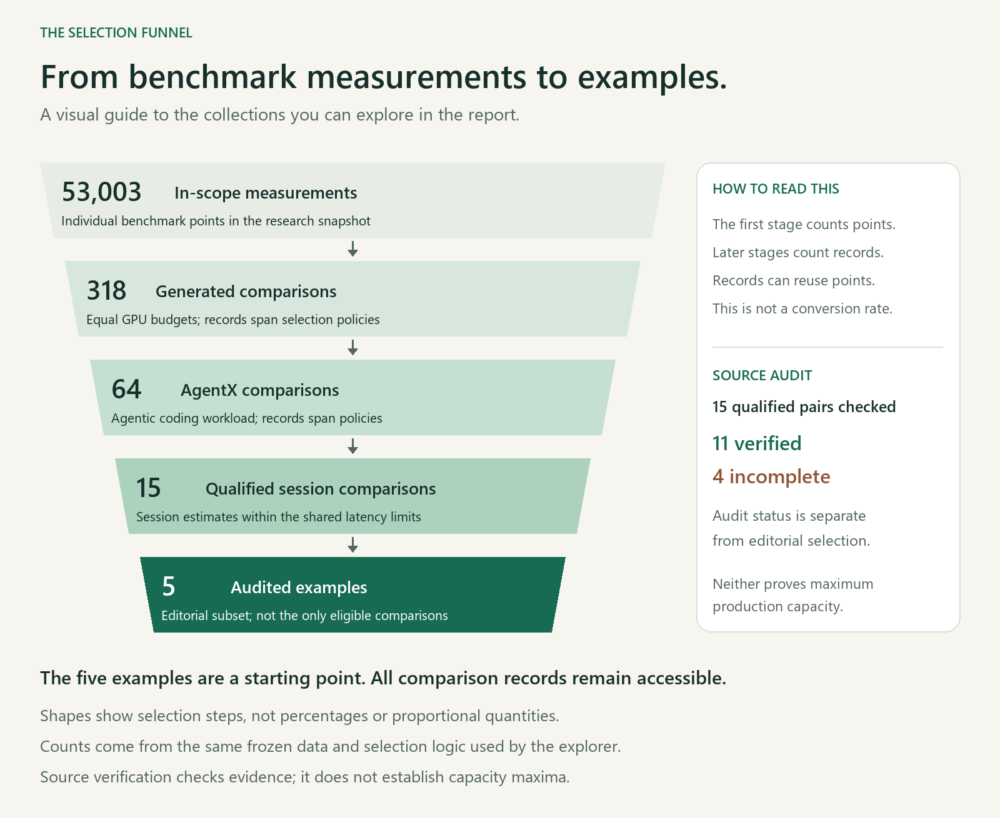
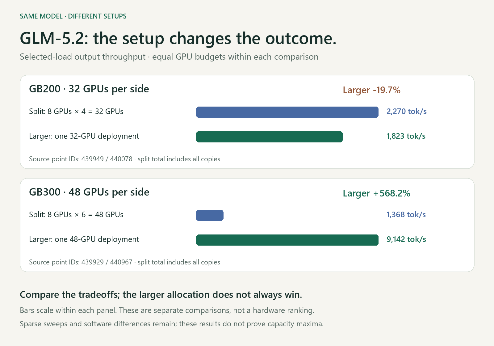

# Compare one model across deployment setups

**Explore how the same model behaves on different hardware, GPU allocations and serving configurations.** Compare output throughput and latency, inspect the tested session load, and estimate active users or daily users with shared, editable assumptions.

[**Open the interactive explorer**](https://inference-report-explorer.frosty-moss-6059.chatgpt.site/report/)



*Data-generated illustration of the comparison workflow. The split side scales one measured smaller deployment; the larger side uses an observed benchmark point.*

## What you can compare

- **One model, several setups:** browse the available hardware families, GPU allocations, frameworks and configuration differences without mixing model-version aliases.
- **Larger allocation versus independent copies:** each pair uses the same model and hardware type at the same total GPU count. The split baseline shows per-copy performance x copies = combined total.
- **Performance and usage tradeoffs:** inspect output tokens per second, first-token and per-token latency, configured root sessions, and planning estimates under the same usage assumptions.
- **The evidence behind a result:** follow benchmark point IDs, source runs, aggregate artifacts, audit status and limitations; download CSV or JSON for your own analysis.

To explore beyond the default examples, select **Collection > All exploratory comparisons**, choose a **Model**, then browse **Hardware** and **Operating point**. Hardware options are a way to browse separate comparisons; equal GPU counts across different hardware types do not imply equal performance or cost.

## How the selection funnel works



*The first stage counts individual measurements; later stages count comparison records, which can reuse points. The funnel shows selection steps, not conversion percentages. Source verification and the choice of illustrative examples are separate; all comparison records remain available in the explorer.*

## The same model can favor different setups



*Each panel has an equal GPU budget within that comparison. Panels use different budgets and are not a hardware ranking. Sparse sweeps and software differences mean these selected results do not isolate a hardware effect or prove maximum capacity.*

The pictures are explanatory diagrams generated from the frozen browser dataset, not UI screenshots. To regenerate them, install Pillow (`python -m pip install Pillow`) and run `python scripts/render-readme-visuals.py`. Numerical labels and bars are calculated from the included data.

For the readable findings, start with the [audited shortlist](reports/inferencex/shortlist.md). For local development, use `http://127.0.0.1:4173/report/` after starting the server. For project continuation, read [the handoff](docs/HANDOFF.md).

## Main outputs

- [Interactive UI guide](docs/REPORT_UI.md): five source-checked editorial examples by default, with all 15 qualified comparisons and all 318 policy records also available. A collapsed “What is this page?” explainer summarizes the method and limitations.
- [Full qualified source audit](reports/inferencex/qualified-audit.md): 11 pairs verified, four incomplete; [machine-readable results](reports/inferencex/qualified-audit.json). All 15 were checked; incomplete pairs share a point missing explicit source GPU totals.

- [Audited shortlist](reports/inferencex/shortlist.md), [CSV](reports/inferencex/shortlist.csv), [JSON and source audit](reports/inferencex/shortlist.json).
- [Broad extraction report](reports/inferencex/report.md) and [all comparison records](reports/inferencex/comparisons.csv).
- [Unified-versus-split scaling analysis](reports/inferencex/scaling-analysis.md), with [machine-readable sensitivity results](reports/inferencex/scaling-analysis.json) and [all qualified AgentX pairs](reports/inferencex/scaling-agentx.csv).
- [Coverage and exclusions](reports/inferencex/coverage.json).
- [Editable coding profile](data/inferencex/profiles/agentx-coding-v1.json).

The shortlist verifies source measurements; it does not establish optimal or production-validated capacity. Source metadata and concurrency-sweep limitations are documented with every example. GB200/GB300 allocations use four-GPU compute-tray equivalents, separately from eight-GPU B200/B300/H200/H100 servers.

## Research commands

Requires Node.js 24+; no npm dependencies for the extractor. Python 3 and an authenticated GitHub CLI are needed only for the source-artifact audit. Run commands from this directory.

```powershell
# Offline regeneration from included snapshots
node scripts/inferencex/report.js
node scripts/inferencex/shortlist.js
node scripts/inferencex/verify-qualified.js
node scripts/inferencex/export-ui.js
node --test tests/inferencex.test.js tests/qualified-audit.test.js tests/report.test.js

# Refresh broad API coverage (network)
node scripts/inferencex/fetch.js --refresh
node scripts/inferencex/provenance.js

# Source audit (network only for uncached GitHub records/artifacts)
python scripts/inferencex/audit_sources.py --all-qualified

# Package data, code, reports, tests and handoff documents
python scripts/inferencex/package.py
```

Changing the broad snapshot can invalidate fixed shortlist row selections. Review the shortlist identities and evidence before regenerating it against refreshed data. Profile changes use `node scripts/inferencex/report.js --profile path/to/profile.json`, then regenerate the shortlist. This overwrites the generated reports with the selected profile; restore the default by rerunning without `--profile`.

## Existing simulator

`app.js`, `index.html`, `styles.css`, the original `data/glm-*` files, and `tests/simulator.test.js` belong to the existing simulator. Its calculations remain separate; its navigation now links to the new InferenceX report at `/report/`.

```powershell
npm.cmd run check
npm.cmd run build
npm.cmd run serve
```

The current public deployment is named **Inference Report Explorer** and is available at https://inference-report-explorer.frosty-moss-6059.chatgpt.site/report/ . Local hosting configuration is excluded from this public repository.

## Documentation

- [Handoff and current state](docs/HANDOFF.md)
- [Methods, units, assumptions and source pitfalls](docs/INFERENCEX_METHOD.md)
- [Work log](docs/WORK_LOG.md)
- [Report UI and refresh instructions](docs/REPORT_UI.md)
- [Active research next steps](docs/INFERENCEX_NEXT_STEPS.md)
- [Archived original extraction design](docs/archive/inferencex-extraction-plan.md)
- [Original simulator specification](ai-model-pool-capacity-simulator-spec.md)

Publication scope and offline reproducibility are documented in [docs/PUBLICATION.md](docs/PUBLICATION.md).
